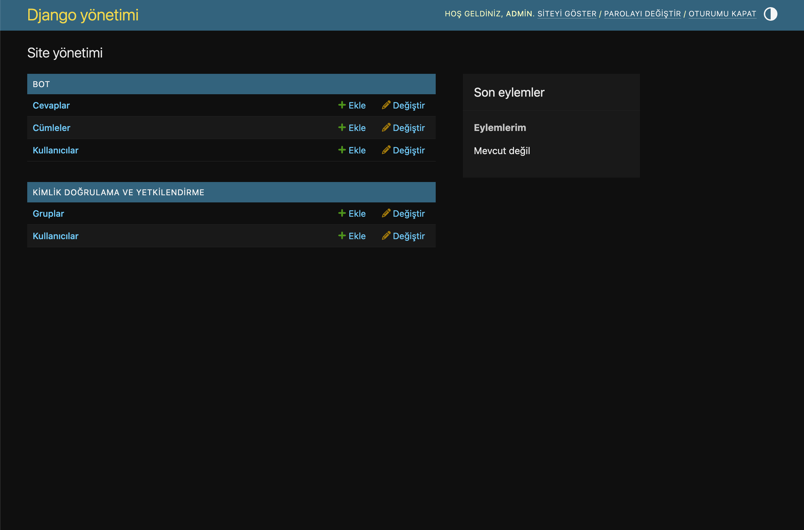

# 🤬 Fuckin' English — Backend API

Learn English the street way — with Turkish curses.

## 🎯 What is this?

An AI-powered English learning app that:
- Teaches A1-C2 sentences
- Curses you in Turkish when you're wrong
- Praises you with curses when you're right
- Explains grammar in street style
- Has voice support (TTS)

## 🛠️ Tech Stack

| Layer | Technology |
|-------|-----------|
| **API** | Flask 3.1 |
| **AI** | Groq (openai/gpt-oss-120b) |
| **Database** | SQLite |
| **Admin** | Django 6.1 |
| **TTS** | edge-tts (tr-TR-AhmetNeural) |
| **Spaced Repetition** | SM-2 algorithm |

## 📁 Project Structure

```
fuckinEnglish/
├── flask_api/
│   ├── app.py              # Flask API (port 5001)
│   ├── ai_engine.py        # Groq AI
│   ├── database.py         # SQLite operations
│   ├── tts.py              # Edge-TTS
│   └── spaced_repetition.py # SM-2 algorithm
├── django_panel/
│   ├── manage.py
│   ├── adminpanel/         # Django project
│   └── bot/                # Django app
├── data/
│   ├── cumleler.json       # 20 sentences
│   ├── fuckin_english.db   # SQLite
│   └── sesler/             # MP3 files
├── notes/                  # Daily notes
├── assets/                 # Screenshots
├── .env                    # API keys
├── .gitignore
├── README.md
└── LICENSE
```

## 📅 11-Day Plan

| Day | Topic | Status |
|-----|-------|--------|
| 1 | Flask skeleton + dummy AI | ✅ |
| 2 | Groq integration | ✅ |
| 3 | 20 sentences + day system | ✅ |
| 4 | SQLite database | ✅ |
| 5 | Spaced repetition (SM-2) | ✅ |
| 6 | Quiz system | ✅ |
| 7 | Django admin panel | ✅ |
| 8 | TTS (voice curses) | ✅ |
| 9 | React Native + Expo | ✅ |
| 10 | AI answer checking | ✅ |
| 11 | Deploy + demo | ⏳ |

## 📸 Screenshots

### Django Admin Panel


## 🚀 Setup

### 1. Clone

```bash
git clone https://github.com/Ramo212121/English_Learn_Street_Style.git
cd English_Learn_Street_Style
```

### 2. Environment

```bash
conda create -n fuckinenglish python=3.12
conda activate fuckinenglish
pip install flask django groq python-dotenv edge-tts flask-cors requests
```

### 3. `.env`

```env
GROQ_API_KEY=gsk_xxxxxxxxxxxxx
```

### 4. Database

```bash
cd flask_api
python database.py
```

### 5. Run Flask

```bash
python app.py
```

**API:** http://localhost:5001

### 6. Run Django Admin (optional)

```bash
cd django_panel
python manage.py runserver 8000
```

**Admin:** http://localhost:8000/admin

## 🔗 API Endpoints

| Endpoint | Method | Description |
|----------|--------|-------------|
| `/` | GET | API info |
| `/gun/<int:gun>` | GET | Get day's sentences |
| `/cumle/<int:gun>/<int:sira>` | GET | Get specific sentence |
| `/sohbet` | POST | Chat with AI |
| `/kullanici` | POST | Create user |
| `/kullanici/<int:id>` | GET | Get user info |
| `/cevapla` | POST | Save answer |
| `/tekrar/<int:id>` | GET | Get review list |
| `/quiz` | GET | Get random question |
| `/quiz/cevapla` | POST | Check answer |
| `/quiz/cevapla-sesli` | POST | Check answer + TTS |
| `/istatistik/<int:id>` | GET | Get statistics |
| `/ses?metin=<text>` | GET | Text to speech |

## 🤬 Curse Levels

| Level | Example |
|-------|---------|
| 🟢 A1 | "Yanlış oldu, bir daha dene." |
| 🟡 A2 | "S*ktiğimin to+be'si kolay len!" |
| 🟠 B1 | "Orospu çocuğu, 'doesn't' olacak!" |
| 🔴 B2 | "A*na koyim, bu ne biçim cümle!" |
| ☠️ C1 | "S*ktiğimin cahili, otur sıfırdan öğren!" |

## 🎁 Features

- ✅ AI-powered answer checking (normalize + varyasyon + AI)
- ✅ Street-style Turkish curses
- ✅ Voice support (TTS)
- ✅ Spaced repetition (SM-2)
- ✅ Statistics tracking
- ✅ Django admin panel
- ✅ CORS enabled

## 📱 Mobile App

**Repo:** [fuckin-english-app](https://github.com/Ramo212121/fuckin-english-app)

React Native + Expo mobile + web app.

## ⚠️ Warning

This project contains profanity. 18+ only.

## 📄 License

MIT License — see [LICENSE](LICENSE)

## 🙏 Credits

- **Groq** — AI infrastructure
- **Edge-TTS** — Voice synthesis
- **Django** — Admin panel
- **Flask** — API framework
